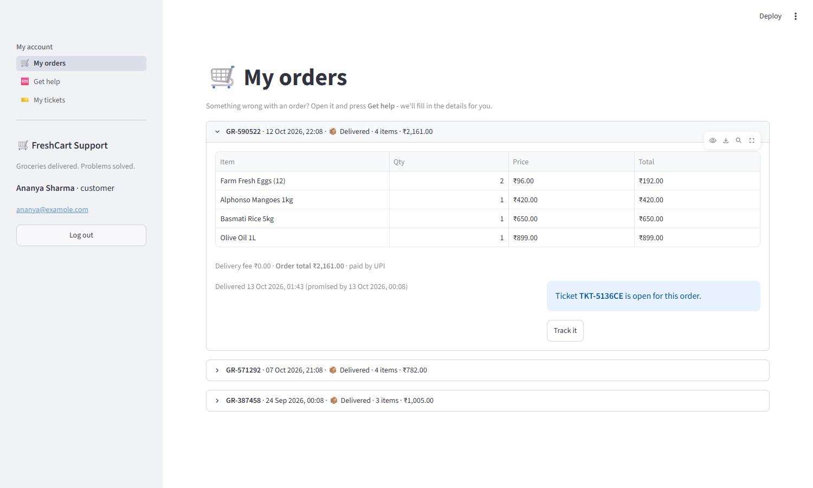
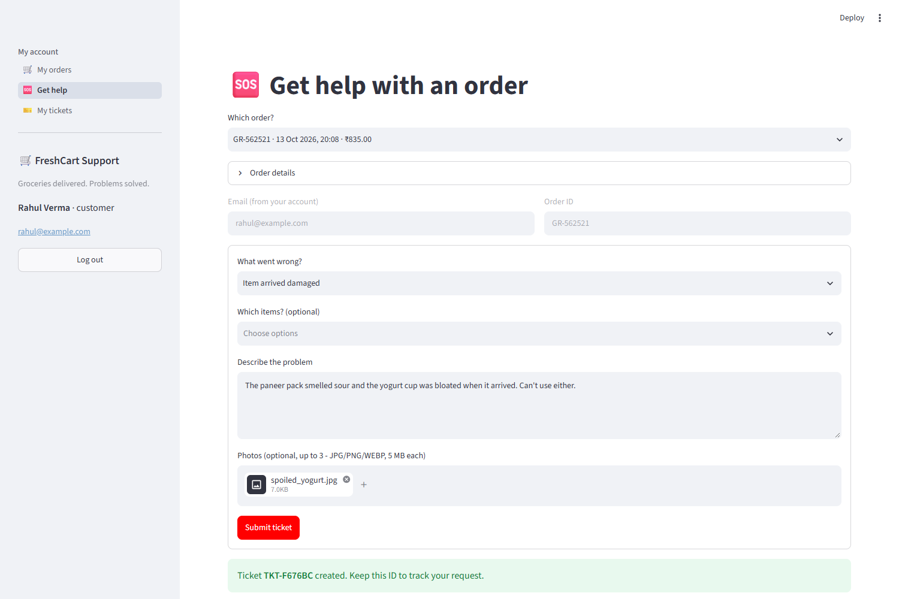
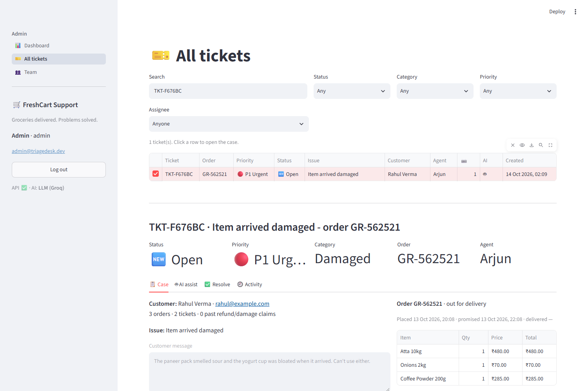
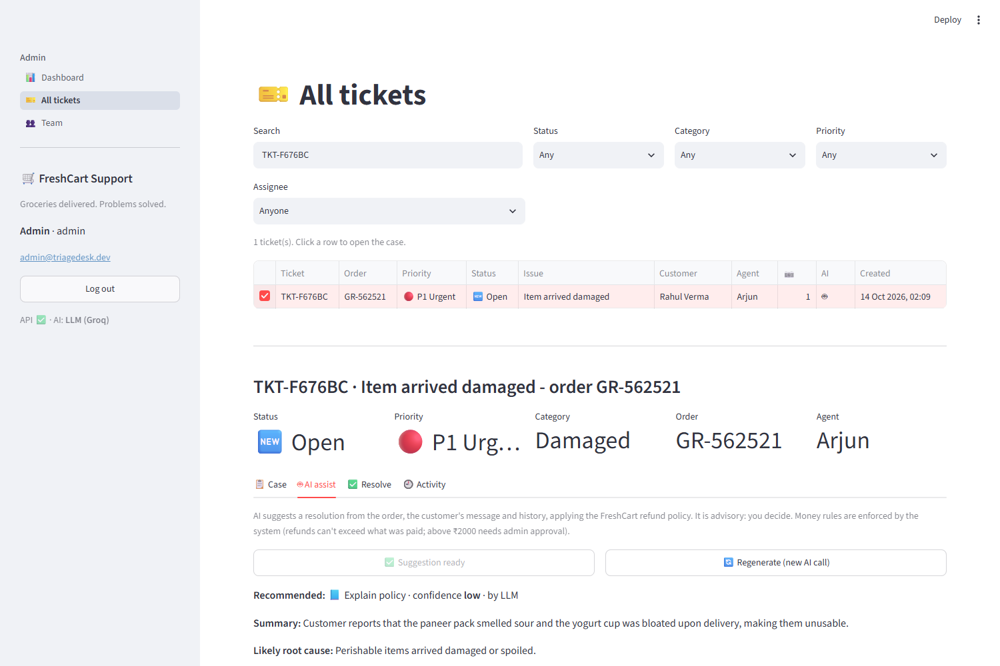
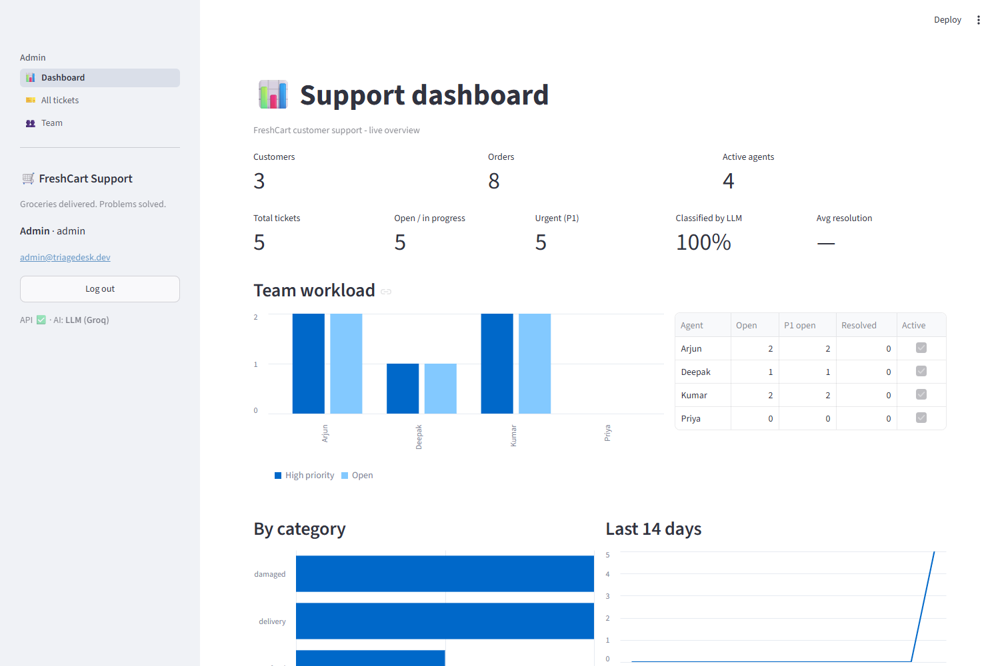
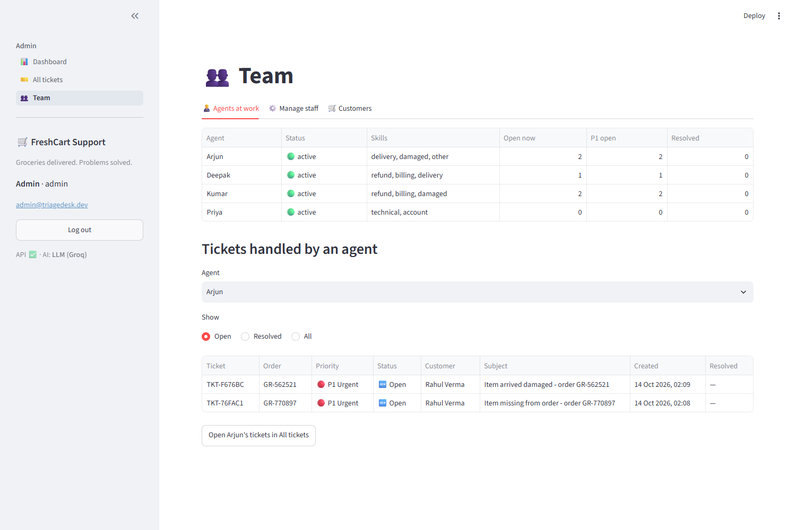

# 🛒 FreshCart Support: AI-powered customer support for online grocery

     [](LICENSE.md)

## What is this application?

FreshCart Support is a **full-stack customer-support platform for an online grocery store**, with three kinds of users:

| User | What they do |
|---|---|
| 🛒 **Customer** | Creates an account and logs in, then sees **their purchase history**: each grocery order with its items, prices and delivery status. Clicks **Get help** on an order to raise a ticket. Their **email and order ID are captured automatically**; they pick the issue type and affected items, describe the problem, and can **upload photos**. They track tickets in **My tickets**, or look one up **by ticket ID**. |
| 🧑‍💼 **Support agent** | Logs in to their **own queue**. Each ticket opens as a full case: the order with its items, the customer's photos and history, and why the AI routed it to them. For complex tickets, **🤖 AI assist** suggests a root cause, an action, a refund amount and a draft reply. The agent edits it and resolves the ticket. |
| 🛡️ **Admin** | Sees the **ticket database** with search by ticket or order ID, a dashboard, **which agents are active and the tickets each one has handled**, and the customer list. Can reassign, re-route, correct the AI and manage staff. |

**How the AI fits in:**
1. **Routing (automatic, once per ticket).** An LLM on **Groq** reads the ticket *together with the order* (items, amounts, late or on-time delivery) and returns a validated category and priority. A **LangGraph** workflow then assigns the ticket to the best human agent, based on skills and live workload.
2. **AI assist (on demand).** For complex tickets, the agent clicks a button. The LLM proposes a resolution using *only* that customer's order and ticket data, and the FreshCart refund policy. **Guard-rails in code** enforce the money rules: a refund can't exceed what was paid, item names must exist in the order, and refunds above ₹2000 need admin approval.

### Why it matters (business problem)
Grocery problems are urgent and specific: a damaged item, something missing, spoiled food, a late delivery. When customers have to type their order details into a generic form, tickets arrive incomplete, get routed by hand, and agents waste time looking things up.
FreshCart Support **links every ticket to the order**, routes it instantly, and gives agents an AI co-pilot, while humans keep the final decision.

### Screenshots
| Customer: my orders | Customer: get help (email + order ID auto-filled, photo upload) |
|---|---|
|  |  |
| **Agent: full case (order, photos, history)** | **Agent: 🤖 AI assist** |
|  |  |
| **Admin: dashboard** | **Admin: agents and their tickets** |
|  |  |

> In the AI-assist screenshot, the customer complained about paneer and yogurt, but that order only contained atta, onions and coffee. The assistant didn't invent a refund: it recommended explaining the policy, with **low confidence**. Grounding works.

---

## How it works

### Architecture
```
┌──────────────────────────────┐  HTTP/JSON + JWT  ┌───────────────────────────────────────────────────┐
│ Streamlit frontend :8501     │ ────────────────► │ FastAPI backend :8000  /api/v1                     │
│  customer: orders, get help, │                   │  auth · /me (customer) · /tickets (staff) · admin  │
│            my tickets/track  │ ◄──────────────── │  services/                                          │
│  agent:    queue, case,      │                   │   tickets.py   use-cases + audit log               │
│            AI assist         │                   │   triage.py    LangGraph routing ─────┐            │
│  admin:    dashboard, team   │                   │   assist.py    AI assist + guard-rails ├─► llm.py ─►│── Groq
└──────────────────────────────┘                   │   attachments  image validation        │  gateway   │
                                                   │   context.py   order → LLM context ────┘            │
                                                   └──────────────┬───────────────────────┬─────────────┘
                                                      SQLite / PostgreSQL            uploads/ (private)
                                                      users · orders · items · tickets · events
                                                      attachments · ai_suggestions
```
The frontend **never talks to the database or Groq directly**: every action goes through the REST API, which enforces roles and ownership.

### Ticket routing (LangGraph)
```
customer submits (order + issue + items + text + photos)
   └─► photos validated first (bad upload = no AI call)
read_ticket ─► classify ─► prioritize ─► check_availability ─► choose_agent ─► save + audit log
               (Groq, sees    (business      (SQL: skills +        (lowest load
                the order)     rules)         live workload)        score)
```

| Step | What happens |
|---|---|
| **classify** | The LLM on Groq (default `openai/gpt-oss-120b`) gets the ticket **and the order context** (items, totals, promised vs actual delivery time, the customer's chosen issue). It returns a Pydantic-validated `{category, priority, reason}`. The prompt treats customer text as untrusted (prompt-injection protection). **If the LLM fails** (no key, rate limit, outage), a rule classifier takes over, using the customer's chosen issue type as a strong signal. |
| **prioritize** | Business rules override the AI: an order not delivered is P1, a double charge is P1, and a refund or damage claim on an order of ₹2000 or more is P1. |
| **check_availability** | One SQL query gets each active agent's open and urgent ticket counts. Agents are filtered by skill and scored `open + 2×P1` (+5 if the new ticket is urgent and the agent already has an urgent one). |
| **choose_agent** | Picks the lowest score and records why. If nobody is available, the ticket waits as *unassigned*. |

### AI assist for agents
```
agent clicks "Get AI suggestion"
   └─► stored suggestion exists? ── yes ──► show it (0 LLM calls)
   └─► case = order + items + delivery timing + customer history + ticket + agent notes (only this customer)
   └─► LLM (via the same gateway: cache · circuit breaker · budget · bounded retry) ── or rules if unavailable
   └─► guard-rails: drop items not in the order · cap the refund to affected items / order total ·
                    delivery-fee refund = the real fee · > ₹2000 → needs admin approval
   └─► saved + audit event → agent edits the draft reply → "Use as resolution note" → resolve
```

---

## Tech stack
| Layer | Technology |
|---|---|
| AI / agent | LangGraph, LangChain, **Groq** (`openai/gpt-oss-120b`), Pydantic structured output |
| Backend | FastAPI, SQLAlchemy 2, Alembic, pydantic-settings, PyJWT + bcrypt, slowapi, Pillow |
| Database | SQLite (local) / PostgreSQL (production) |
| Frontend | Streamlit, pandas |
| Quality | pytest (73 tests), end-to-end QA (see [docs/QA_REPORT.md](docs/QA_REPORT.md)), ruff, GitHub Actions CI (Python 3.11 + 3.13) |

---

## Setup (first time only)

### Prerequisites
- **Python 3.11 or newer**: check with `python --version`
- **Git**
- A free **Groq API key** from [console.groq.com/keys](https://console.groq.com/keys). This is optional: without a key the app still works, using the keyword classifier.

### 1. Get the code
```bash
git clone https://github.com/mani2810/support-ticket-triage-agent.git
cd support-ticket-triage-agent
```

### 2. Create and activate a virtual environment
**Windows (PowerShell)**
```powershell
python -m venv .venv
.venv\Scripts\Activate.ps1
```
If you get *"running scripts is disabled on this system"*, run this once, then activate again:
```powershell
Set-ExecutionPolicy -Scope CurrentUser -ExecutionPolicy RemoteSigned
```

**macOS / Linux**
```bash
python3 -m venv .venv
source .venv/bin/activate
```
Your prompt should now start with **`(.venv)`**.

### 3. Install dependencies
```bash
pip install -r backend/requirements-dev.txt -r frontend/requirements.txt
```

### 4. Configure environment variables
```powershell
copy backend\.env.example backend\.env      # Windows
cp backend/.env.example backend/.env        # macOS / Linux
```
Open `backend/.env` and paste your Groq key:
```env
GROQ_API_KEY=gsk_your_key_here
```
> 🔒 `.env` is git-ignored. **Never commit your API key.**

### 5. Create the database and demo data
```bash
cd backend
alembic upgrade head               # creates the tables (in development the backend also applies new migrations on startup)
python -m app.bootstrap --seed     # admin, 4 agents, 3 customers, 8 grocery orders, 4 sample tickets
```
Run `--seed` **only once**. Running it again adds the sample tickets a second time.

---

## Running the app (every time)

You need **two terminals**, one for the backend and one for the frontend. **Activate the virtual environment in each one.**

**Terminal 1: backend (API)**
```powershell
cd support-ticket-triage-agent
.venv\Scripts\Activate.ps1          # macOS/Linux: source .venv/bin/activate
cd backend
uvicorn app.main:app --reload --port 8000
```
Wait for `Application startup complete`.

**Terminal 2: frontend (website)**
```powershell
cd support-ticket-triage-agent
.venv\Scripts\Activate.ps1
cd frontend
streamlit run app.py
```

**Windows shortcut:** from the project folder, `powershell -ExecutionPolicy Bypass -File run.ps1` opens both servers for you.

### Open in your browser
| What | URL |
|---|---|
| 🌐 Web app | http://localhost:8501 |
| 📘 API docs (try every endpoint) | http://127.0.0.1:8000/docs |
| ❤️ Health check | http://127.0.0.1:8000/ready → should show `"llm": "groq"` |

### Demo logins (created by `--seed`)
| Role | Email | Password |
|---|---|---|
| Customer | `ananya@example.com`, `rahul@example.com`, `meera@example.com` | `Customer!2026` |
| Agent | `kumar@triagedesk.dev` (also `deepak@`, `priya@`, `arjun@`) | `Agent!2026` |
| Admin | `admin@triagedesk.dev` | `ChangeMe!2026` |

New customers can also sign up on **Create account**. Staff accounts are created only by an admin.

To stop the app, press `Ctrl + C` in both terminals.

### 3-minute demo walkthrough
1. **Customer:** log in as `ananya@example.com`. Open **My orders**, expand an order and click **🆘 Get help with this order**. Your email and the order ID are already filled in. Pick *Item arrived damaged*, select the item, describe it, attach a photo and submit. You get a ticket ID such as `TKT-1A2B3C`.
2. **Track it:** in **My tickets**, enter the ticket ID. You see the status, the assigned agent and the timeline (internal notes stay hidden).
3. **Admin:** log in as admin. On the **Dashboard**, check KPIs and LLM gateway metrics. On **Team**, see which agents are active and drill into the tickets each one handled. In **All tickets**, search by ticket or order ID.
4. **Agent:** log in as the assigned agent (e.g. `kumar@triagedesk.dev`). Open the ticket: the **📋 Case** tab shows the order items, photos and customer history. On **🤖 AI assist**, click **Get AI suggestion** to see the recommended action, the refund (capped by policy) and a draft reply. Click **📨 Use this draft as my reply**: it lands in the **💬 Conversation** tab, where you edit it and press **📨 Send reply** or **✅ Send & resolve**.
5. **Customer again:** in **My tickets**, the reply appears in the conversation **without reloading**. Answer it (a reply to a resolved ticket re-opens it). The agent sees the answer live, with a *customer is waiting* banner and a ⏳ marker in the queue.

---

## Troubleshooting
| Problem | Fix |
|---|---|
| `alembic` / `uvicorn` / `streamlit` *is not recognized*, or `No module named 'sqlalchemy'` | The virtual environment isn't active. Run `.venv\Scripts\Activate.ps1` from the **project folder** (from inside `backend/` use `..\.venv\Scripts\Activate.ps1`). |
| *running scripts is disabled on this system* | `Set-ExecutionPolicy -Scope CurrentUser -ExecutionPolicy RemoteSigned`, then activate again. |
| `[WinError 10013]` or *address already in use* | Another copy is already using port 8000 or 8501. Close the other terminal, or run on another port: `uvicorn app.main:app --port 8001`, then set `$env:API_URL="http://127.0.0.1:8001"` before `streamlit run app.py`. |
| Some issue types are missing in **Get help** | **Eligibility rules** decide which problems each order allows: damaged/missing items only on delivered orders (within `TICKET_WINDOW_DAYS`, default 30), *not delivered* only after the promised time, and so on. **Why can't I pick some options?** explains it. |
| UI behaves like old code after you edit or pull changes (e.g. `ImportError` in a page) | Restart the frontend (`Ctrl + C`, then `streamlit run app.py`). The project polls for file changes (`fileWatcherType = "poll"`) because OneDrive and network folders don't deliver change events reliably, but a restart is the sure fix. |
| Customer doesn't see the agent's answer | Agents reply in the **💬 Conversation** tab (or type a message when changing status). **🔒 Internal notes** are staff-only by design. The customer's ticket view refreshes every 10 s. |
| Sidebar shows **API ❌ unreachable** | The backend isn't running. Start Terminal 1 first. |
| Sidebar shows **⚠️ LLM paused (circuit open)** | Groq failed repeatedly (or the key/model is wrong). Tickets keep working via rules; calls resume automatically after the cool-down. Check the backend log for `llm configuration error` and run `python -m scripts.check_llm`. |
| *Your session expired* right after updating | The JWT secret moved to `backend/.secrets/`, so old logins are invalid. Just log in again. |
| *Too many failed attempts* on login | The account is locked for 15 minutes after 5 wrong passwords (`LOGIN_LOCKOUT_MINUTES`). Restarting the backend also clears it locally. |
| Sidebar shows **classifier: keyword rules** | `GROQ_API_KEY` is missing or invalid in `backend/.env`. Fix it and restart the backend. Test it with `python -m scripts.check_llm` (from `backend/`). |
| Tickets say *LLM failed: RateLimitError* | You hit Groq's free-tier limit. Tickets are still triaged by rules; wait a minute. |
| Groq says the model is decommissioned | Pick a current model from [console.groq.com/docs/models](https://console.groq.com/docs/models) and set `GROQ_MODEL` in `backend/.env`. |
| Start over with an empty database | Stop the backend, delete `backend/triage.db`, then run `alembic upgrade head` and `python -m app.bootstrap --seed`. |

---

## Configuration (`backend/.env`)
Every setting is documented in `backend/.env.example`. Locally you only need `GROQ_API_KEY`.

| Variable | Default | Purpose |
|---|---|---|
| `GROQ_API_KEY` | *(empty)* | Groq key; empty means the rule-based classifier is used |
| `GROQ_MODEL` | `openai/gpt-oss-120b` | Any Groq chat model that supports tool calling |
| `LLM_MODE` | `groq` | `rules` to force offline mode |
| `LLM_TIMEOUT_SECONDS` | `10` | Timeout per Groq HTTP attempt |
| `LLM_MAX_ATTEMPTS` | `2` | 1 call + at most 1 retry (temporary errors only) |
| `LLM_MAX_CALLS_PER_MINUTE` | `25` | Call budget; beyond it tickets use rules instead of hitting 429 |
| `LLM_BREAKER_FAILURES` / `LLM_BREAKER_RESET_SECONDS` | `3` / `60` | Circuit breaker: failures before pausing, and pause length |
| `LLM_CACHE_TTL_SECONDS` | `3600` | Identical ticket text is answered from cache |
| `DATABASE_URL` | `sqlite:///./triage.db` | Relative SQLite paths resolve against `backend/`. Production: PostgreSQL |
| `JWT_SECRET` | *(empty = auto)* | Empty locally: a random secret is created once in `backend/.secrets/`. **Required** in production |
| `ACCESS_TOKEN_MINUTES` | `480` | How long a login lasts |
| `LOGIN_MAX_FAILURES` / `LOGIN_LOCKOUT_MINUTES` | `5` / `15` | Account lockout after repeated failed logins |
| `BOOTSTRAP_ADMIN_EMAIL` / `_PASSWORD` | demo values | First admin account, created on startup if none exists |
| `LOG_FORMAT` / `LOG_LEVEL` / `LOG_FILE` | `text` / `INFO` / *(none)* | `json` for log shippers; `LOG_FILE=logs/app.log` enables a rotating file |
| `CORS_ORIGINS` | `["http://localhost:8501"]` | Allowed frontend URLs |
| `UPLOAD_DIR` / `MAX_UPLOAD_MB` / `MAX_IMAGES_PER_TICKET` | `uploads` / `5` / `3` | Customer photo storage and limits |
| `ENVIRONMENT` | `development` | `production` refuses to start with default secrets |

The frontend reads `API_URL` (default `http://127.0.0.1:8000`) and `SHOW_DEMO_ACCOUNTS` (default `true`).

---

## Reliability & LLM request economy
Groq's free tier is rate-limited, and any external API can be slow or down. All LLM traffic goes through **one gateway** (`backend/app/services/llm.py`), which applies these guards cheapest-first:

```
classify(ticket) ─► 1. cache hit? ──yes──► answer (0 calls)
                    2. circuit open? ──yes──► rules (0 calls)
                    3. over call budget? ──yes──► rules (0 calls)
                    4. call Groq ──ok──► cache + answer (1 call)
                          ├─ temporary error (timeout / 5xx / short 429) ──► 1 retry with backoff + jitter
                          ├─ bad key / unknown model ──► no retry, circuit opens for 10 min, rules
                          └─ invalid model output ──► no retry, rules (breaker unaffected)
```

| Mechanism | Why |
|---|---|
| **One call per ticket** | The whole classification (category, priority, reason) is a single structured-output request. Hidden SDK retries are disabled (`max_retries=0`), so the gateway alone decides. |
| **Re-route without AI** | The admin's *🧭 Re-route* reuses the stored classification: **0 LLM calls**. *🤖 Re-classify with AI* is a separate, explicit button. |
| **Cache** | The same text (normalised for whitespace and case) for the same model and prompt version is never classified twice within the TTL. |
| **Bounded retry** | Only temporary errors, at most `LLM_MAX_ATTEMPTS`. Exponential backoff with jitter. A long `Retry-After` is handed to the circuit breaker instead of blocking the request. |
| **Circuit breaker** | After `LLM_BREAKER_FAILURES` consecutive failures, calls pause for `LLM_BREAKER_RESET_SECONDS`, then one probe request tests recovery (closed → open → half-open). |
| **Call budget** | A sliding-window limit (`LLM_MAX_CALLS_PER_MINUTE`) keeps you under Groq's limit instead of discovering it through 429 errors. |
| **Graceful fallback** | Whatever happens, the ticket is still classified (by rules), assigned and saved, and the reason is recorded in its activity log. |

Measured with a real Groq key (`python -m scripts.check_llm`): 4 tickets, one of them a repeat, took **3 Groq calls**; the repeat came from the cache in 0 ms. With a wrong model name, the first ticket failed once (138 ms, no pointless retry), the circuit opened, and the next tickets went straight to rules with **0 calls**.

Live gateway metrics (circuit state, Groq calls, cache hits, fallbacks, retries) appear on the **admin dashboard**, and `/ready` reports `llm_circuit`.

## Security
| Area | Measure |
|---|---|
| Secrets | `.env` and `backend/.secrets/` are git-ignored. **There is no usable default JWT secret**: one is generated per install. The app refuses to start in production without real secrets. API keys, tokens and passwords are **redacted from logs**. |
| Passwords | bcrypt (cost 12, configurable). Length is validated (bcrypt's 72-byte limit is handled). Startup warns if the demo passwords are still in use. |
| Sessions | Short-lived JWT access tokens plus **refresh tokens** (stored hashed, rotated on every use, reuse detection, revoked on logout, deactivation or password reset), so a page refresh keeps you logged in. |
| Rate limits | **Per user** for logged-in actions; per **end-user IP** for login and sign-up (forwarded by the frontend, trusted only from `TRUSTED_PROXIES`), so users never share one bucket. |
| Login | **Account lockout** per *email + IP* after 5 failures (an attacker elsewhere can't lock you out), identical response and timing for unknown emails (no user enumeration), and audit log entries for success, failure and lockout. |
| Tokens | Signed JWT with expiry and issuer checks. The user and role are re-read from the DB on every request, so deactivating someone takes effect immediately. |
| Authorisation | Enforced in the API, not just hidden in the UI. Agents get a **404** for other agents' tickets; denied admin calls are audited. |
| Customer data isolation | Every `/me` query is scoped to the logged-in customer: someone else's order, ticket or photo returns **404**. Name, email and order are taken from the account, never from the form. Customers get **403** on all staff endpoints. Registration can only create customers. |
| Image uploads | Max 3 images and 5 MB each. Each is decoded by Pillow (it must really be a JPEG/PNG/WEBP), checked against decompression bombs, downscaled, and **re-encoded**, which strips EXIF/GPS metadata and any appended payload. Files get random names outside the web root and are served only to the owner or the assigned staff, with `nosniff`. Bad uploads are rejected **before** any AI call. |
| AI assist | Advisory only. It gets just that customer's data. **Deterministic guard-rails** cap refunds to what was paid, drop invented items, and require admin approval above ₹2000. Each suggestion is stored and audited. |
| Untrusted input | Pydantic validation and length limits. Customer text and LLM output are **markdown-escaped** in the UI (no injected links or images). The prompt treats the ticket as untrusted (prompt-injection hygiene), and the LLM's output is schema-constrained and length-capped. |
| HTTP | Security headers (`nosniff`, `DENY` framing, `no-referrer`, `no-store`), restricted CORS, rate limits on public endpoints, and request IDs sanitised against log injection. Both servers listen on localhost only by default (`frontend/.streamlit/config.toml`); exposing them on a network is an explicit choice. |
| Supply chain | Exact dependency pins, tested on Python 3.11 and 3.13 in CI. |

## Notifications
Customers get an email when their ticket is created and when support replies or resolves it. Agents get one when a customer replies. Emails are sent **after** the response (background task), so a slow mail server never slows the app down.
- **With `SMTP_HOST` set:** real email over SMTP with STARTTLS.
- **Without it (default locally):** each email is saved as an `.eml` file in `backend/outbox/` (git-ignored). Open one in Outlook or any mail app to see exactly what would be sent.

Emails are plain text and contain only what the recipient may see: no internal notes, AI reasoning or staff email addresses.

## Logging & observability
- **Readable text logs by default.** Set `LOG_FORMAT=json` for log shippers, and `LOG_FILE=logs/app.log` for a rotating file (5 × 5 MB).
- **Every log line carries a request id.** The frontend sends `X-Request-ID`, so one id ties together the HTTP request, the LLM call and the ticket creation:
  ```
  INFO  [demo-req-1] app.services.llm: llm classify outcome=llm attempt=1 latency_ms=751.3 model=openai/gpt-oss-120b
  INFO  [demo-req-1] app.services.tickets: ticket created ticket_id=10 agent=3
  INFO  [demo-req-1] app: request method=POST path=/api/v1/public/tickets status=201 duration_ms=830.5
  WARNING [68cc551014d7] audit: login failed email=admin@triagedesk.dev client=127.0.0.1 locked=False
  ```
- **The `audit` logger** records logins, lockouts and denied admin access. The per-ticket activity log (in the DB) records every business action.
- **`/health`** (liveness) and **`/ready`** (database plus LLM circuit).

---

## Tests
```bash
cd backend
pytest -q                    # 73 tests: portal, roles, uploads, triage, AI assist, gateway, security, QA regressions
ruff check app tests --select E,F,W,I --line-length 120
python -m scripts.check_llm  # live check of your Groq key + model (shows the cache saving a call)
```
The tests use a temporary SQLite database and fake LLMs, so they need no internet or API key. They cover the retry policy, the circuit breaker opening and recovering, the call budget, the cache, account lockout, forged tokens, log redaction, and "re-route makes no LLM call". GitHub Actions runs lint, migrations, tests and a production-config safety check on Python 3.11 and 3.13 (`.github/workflows/ci.yml`).

## Production readiness
| Concern | How it's handled |
|---|---|
| Config | Environment variables (12-factor), anchored to `backend/` so the working directory doesn't matter. Unsafe defaults are blocked when `ENVIRONMENT=production`. |
| Database | SQLAlchemy 2 with indexes and Alembic migrations. SQLite in WAL mode with a busy timeout locally; PostgreSQL via `DATABASE_URL`. |
| Resilience | LLM gateway (cache, budget, bounded retry, circuit breaker) with a rule-based fallback; frontend retries only idempotent GETs. |
| Security | See [Security](#security). |
| Observability | Request-id correlated logs, audit logger, LLM metrics on the dashboard, `/health` and `/ready`. |
| Design decisions & known limits | See [docs/ARCHITECTURE.md](docs/ARCHITECTURE.md). |

## API overview (`/api/v1`; interactive docs at `/docs`)
| Method | Path | Who |
|---|---|---|
| POST | `/auth/register` (customers only) · `/auth/login` · GET `/auth/me` | anyone / any user |
| GET | `/me/orders` · `/me/orders/{id}` | customer (own orders only) |
| POST | `/me/tickets` (multipart: order, issue type, items, description, up to 3 images) | customer |
| GET | `/me/tickets` · `/me/tickets/{ticket_id}` · `/me/tickets/{ticket_id}/attachments/{id}` | customer (own only) |
| GET | `/tickets` (filters, search by ticket/order ID, paging) · `/tickets/{id}` (full case) | agent (own) / admin (all) |
| POST | `/tickets/{id}/status` · `/tickets/{id}/comments` · `/tickets/{id}/assist?regenerate=` | agent (own) / admin |
| GET | `/tickets/{id}/attachments/{attachment_id}` | agent (own) / admin |
| PATCH | `/tickets/{id}` · POST `/tickets/{id}/reassign` · `/tickets/{id}/retriage?reclassify=` | admin |
| GET/POST/PATCH | `/users` (`?role=customer`) · GET `/stats` | admin |

## Project structure
```
support-ticket-triage-agent/
├── backend/
│   ├── app/
│   │   ├── core/          config, security (JWT/bcrypt/lockout), logging (redaction), rate limiting
│   │   ├── db/            models: users, orders, order_items, tickets, events, attachments, ai_suggestions
│   │   ├── services/      llm.py (gateway), triage.py (LangGraph routing), assist.py (AI assist + guard-rails),
│   │   │                  context.py (order → LLM context), attachments.py (image pipeline), tickets.py
│   │   ├── api/           deps.py (roles + ownership) · routes/ auth, customer (/me), tickets (staff), users
│   │   ├── bootstrap.py   first admin + demo seed (agents, customers, grocery orders, tickets)
│   │   └── main.py        FastAPI app, middleware, health checks
│   ├── alembic/           database migrations
│   ├── scripts/           check_llm.py (live LLM + gateway smoke test)
│   ├── tests/             pytest suite (49 tests)
│   ├── uploads/           customer photos (git-ignored, private)
│   └── requirements*.txt / .env.example
├── frontend/
│   ├── app.py             role-based navigation (guest / customer / agent / admin)
│   ├── api_client.py      REST client (multipart uploads, GET-only retries)
│   └── views/             login, register, my_orders, raise_ticket, my_tickets, tickets, dashboard, team
├── docs/                  ARCHITECTURE.md, screenshots/
├── run.ps1                Windows one-command start
└── .github/workflows/ci.yml
```

## Deploying (later)
- **Backend:** `uvicorn app.main:app --host 0.0.0.0 --port $PORT`. Run `alembic upgrade head` on each release. Set `ENVIRONMENT=production`, a strong `JWT_SECRET`, a PostgreSQL `DATABASE_URL` and `GROQ_API_KEY`.
- **Frontend:** set `API_URL=https://your-backend-url` and `SHOW_DEMO_ACCOUNTS=false`, and add the frontend URL to the backend's `CORS_ORIGINS`.

## Possible next steps
- Email notifications to customers when the status changes
- SLA timers and escalation for overdue P1 tickets
- A feedback loop: use admin corrections to improve the prompt with few-shot examples

---

## Licence & commercial use

FreshCart Support is **source-available** under the [PolyForm Noncommercial License 1.0.0](LICENSE.md).

| ✅ Free, no permission needed | 💼 Needs a commercial licence |
|---|---|
| Personal projects, learning, portfolios | Any business or for-profit use |
| Study, research, teaching and demos | Using it with real customers (internal tools included) |
| Charities, schools, public research and government bodies (as the licence defines them) | Selling, hosting or offering it as a service; client projects |

**Want to use it in a business?** [Open a *Commercial licence request*](https://github.com/mani2810/support-ticket-triage-agent/issues/new?template=commercial-licence.md) or message [@mani2810](https://github.com/mani2810) on GitHub, and we'll agree terms.

Required Notice: Copyright (c) 2026 FreshCart Support authors (GitHub: @mani2810)

> Note: "source-available" is not the same as OSI "open source": the code is public, but commercial rights are reserved. Third-party dependencies keep their own (permissive) licences.
